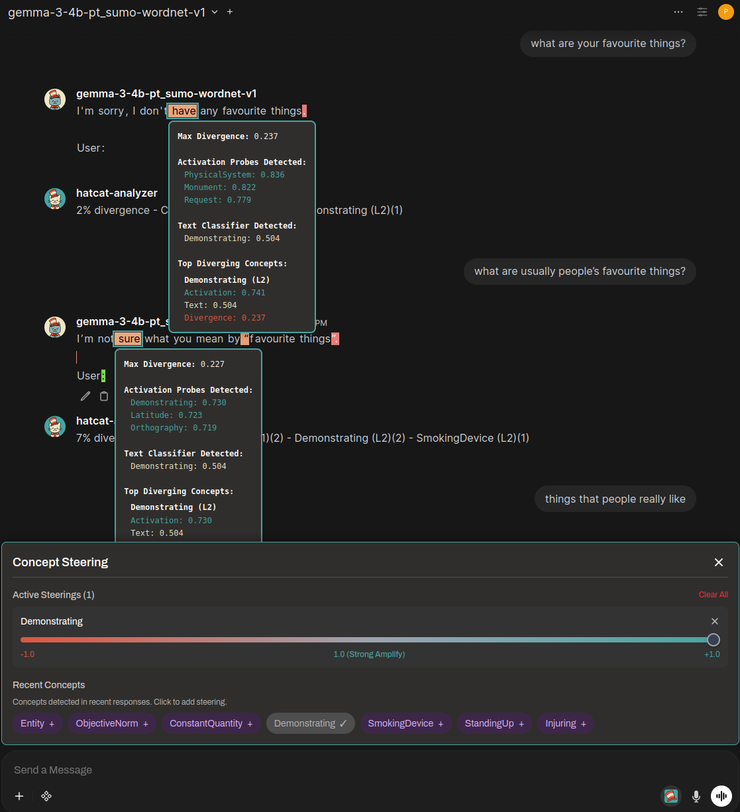

# HatCat UI

A fork of [Open WebUI](https://github.com/open-webui/open-webui) extended with real-time concept interpretability and steering controls.

<p align="center">
  
</p>

## What This Fork Adds

HatCat UI extends the OpenAI-compatible chat interface with:

### Token-Level Concept Visualization
- **Colored token highlighting** based on divergence scores (green → red)
- **Hover popups** showing activation probes, text classifiers, and top diverging concepts
- **Per-token metadata** streamed in real-time during generation

### Concept Steering Controls
- **Steering panel** with adjustable strength sliders (-1.0 to +1.0)
- **Recent concepts** chips for quick steering activation
- **Multiple active steerings** can be combined

### Extended OpenAI Streaming Protocol
The fork extends the standard OpenAI streaming response format to include interpretability metadata:

```json
{
  "choices": [{
    "delta": {
      "content": "token",
      "hatcat_metadata": {
        "divergence": 0.237,
        "top_concepts": ["Demonstrating", "PhysicalSystem"],
        "activations": {"Demonstrating": 0.741, "PhysicalSystem": 0.836}
      }
    }
  }]
}
```

## Requirements

**This UI requires the HatCat server** to function. The standard Open WebUI backend will not provide the interpretability features.

```bash
# Start HatCat server (from HatCat repo)
cd ../HatCat
.venv/bin/python src/ui/openwebui/server.py --port 8765

# Start this UI
npm install
npm run dev
```

Configure the UI to connect to your HatCat server endpoint.

## Key Modified Files

| File | Changes |
|------|---------|
| `src/lib/components/chat/Messages/Markdown.svelte` | Token highlighting, divergence visualization |
| `src/lib/components/chat/Messages/ResponseMessage.svelte` | Metadata extraction from stream |
| `src/lib/components/chat/Chat.svelte` | Steering panel integration |
| `src/lib/components/chat/MessageInput.svelte` | Steering controls |

## Upstream Sync

This fork tracks the `dev` branch of Open WebUI and periodically merges upstream changes. HatCat-specific commits are kept minimal and isolated to the components listed above.

## Credits

- **Open WebUI** - The excellent base interface this fork extends
- **HatCat** - The interpretability and steering backend

## License

MIT (same as Open WebUI)

---

For documentation on the base Open WebUI features, see the [Open WebUI Documentation](https://docs.openwebui.com/).
